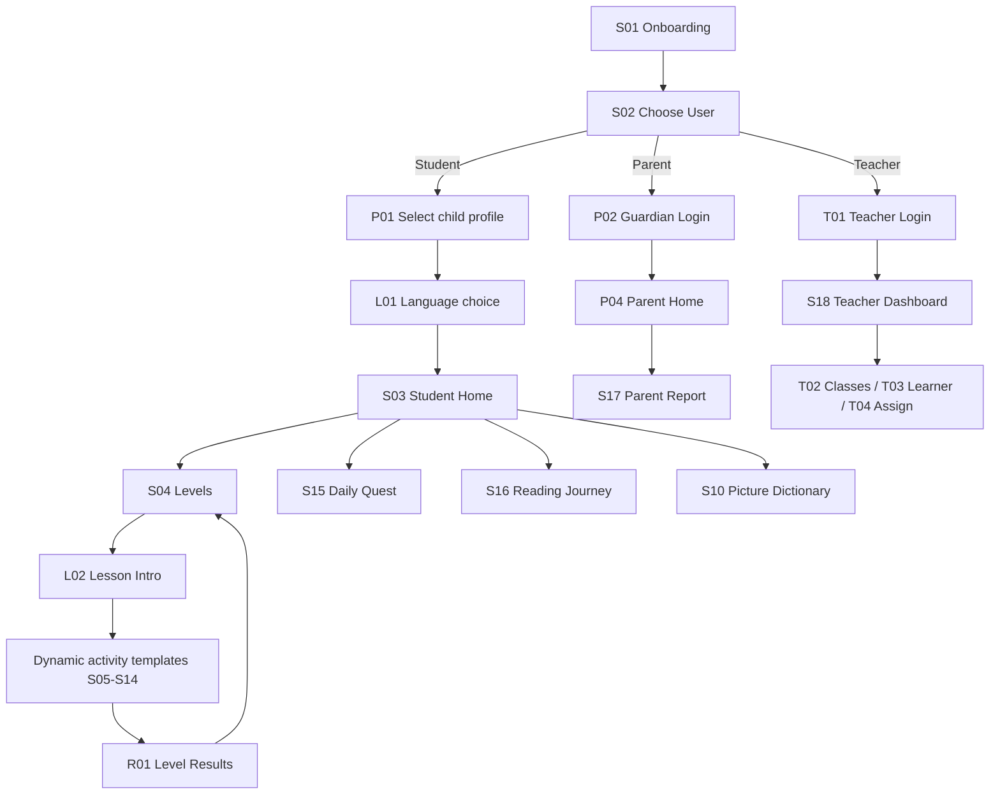

# BasaBuddy — Full Product, UI/UX, Curriculum and Developer Specification
**Spec ID:** BB-SPEC-1.1  |  **Date:** 2026-11-02  |  **Target:** Android first (iPhone 16 design reference, 393 × 852)  |  **Audience:** Grades 1–3, Filipino and English

## Evidence classification
- **Existing/project-established:** BasaBuddy name; mascot; pastel-blue theme; intended audience; 18-screen design target; 393 × 852 reference size.
- **Previously reported, not verified in this session:** there are 18 editable 393 × 852 Figma frames and some prototype links in the existing file. The screen inventory below is reconstructed from that prior report.
- **NOT visually verified:** actual frame names, typography, padding, clipping, component variants, current links and all individual screen pixels. A visual audit must be completed against exports; the following audit is a *targeted inspection checklist*, not a claim that a flaw exists.
- **Proposed:** every behavior, architecture, flow, curriculum item, metric and additional view unless an explicit note says otherwise.

**Hard constraint:** Do not open, mutate or regenerate the user's existing Figma file through an integration. Retain its native editable layers and existing brand identity. Do not replace frames with flat screenshots.

## Product definition
BasaBuddy is a child-friendly, bilingual reading practice app. The student can listen, decode, blend, match, build sentences, read short stories, answer questions and review progress. Parents see only their linked children, and authorized teachers see only their enrolled learners. Learning content is organized by skills, not presumed grade equivalence.

**What success means:** (1) all original 18 screens implemented as functional reusable templates, (2) 18 levels in two independent tracks, (3) no dead-end navigation, (4) offline core lessons with durable progress, (5) safe adult-only data views, (6) accessible feedback, (7) accurate language-specific audio, (8) a real Android build validated on devices.

## 1. Screen-by-screen audit (provisional)
Every item below is a check to perform or a proposed target, not evidence of a defect.

| ID | Reported screen type | Proposed purpose | Audit / correction checklist |
|---|---|---|---|
| S01 | Onboarding | Intro with owl and a single primary Continue | Verify full safe area, mascot clipping, CTA contrast and readable instruction |
| S02 | Choose User | Role selection; Student, Parent, Teacher | Ensure choosing an adult role never grants access without authentication |
| S03 | Student Home | Resume current level and show lightweight progress | Check consistent header and bottom tab positions; avoid multiple competing main CTAs |
| S04 | Learning Levels | 18 sequential levels, chosen-language progress | Audit row/card size, locked contrast, long titles and completed badges |
| S05 | Syllable Lesson | Show phoneme/syllable instruction and teacher-model audio | Ensure all tiles remain readable and playable; do not assume Filipino syllables equal English phonics |
| S06 | Word Reading | Word, image, audio and guided blending | Confirm font/line-height and picture-word alignment; avoid tiny navigation arrows |
| S07 | Listen & Repeat | Model playback and optional child voice replay | Show microphone permission, recording state, fallback to non-mic path |
| S08 | Syllable Puzzle | Build a word using syllable/phoneme chips | Make a tap-based alternative to drag-and-drop; show selected and incorrect states |
| S09 | Read Aloud | Short prompt and optional reading check | No unsupported automatic pronunciation scoring; check microphone and offline states |
| S10 | Picture Dictionary | Picture and category browsing with exact bilingual assets | Audit grid density and language-specific narration; no automatic text-only translations |
| S11 | Story Reading | Short story with page progression and narrator audio | Verify long-content scrolling and bottom safe-area CTA; do not place overlays on story text |
| S12 | Story Quiz | One age-appropriate question per screen | Use plain-language feedback; choice state and retry state must be visible |
| S13 | Find the Word | Find requested word in limited choices | Avoid tiny targets, hidden answer cues, and confusing mixed languages |
| S14 | Sentence Builder | Arrange word chips in grammatical order | Support taps and reorder accessible controls in addition to dragging |
| S15 | Daily Quest | Optional daily practice cycle and positive completion | No penalties for inactivity; visibly distinguish available versus done |
| S16 | Reading Journey | Show mastery and completed skills by language | Ensure charts use labels, not color alone; distinguish progress from grade score |
| S17 | Parent Report | Child progress, skills and family practice suggestions | Adult-only viewing; explain scores and dates; verify no teacher-only functions |
| S18 | Teacher Dashboard | Authorized class summary, assignments and learner progress | No student data without authorized enrollment and access checks |

### Cross-screen visual checks
1. Export each current frame at 1× PNG and verify it is 393 × 852 before making edits. Also preserve a reference screenshot of the layer panel when possible.
2. Verify top and bottom safe areas; never position interactive actions underneath the Dynamic Island, status bar, home indicator or Android system bars. 393 × 852 is a **design reference**, not a constraint on Android runtime screen sizes.
3. Compare top titles, back arrow positions, card radii, icon stroke, bottom tabs, word-card proportions, mascot placement, and CTA heights across the same screen families.
4. Inspect 200% text zoom (where supported), long Filipino/English labels, dynamic line breaks, landscape handling or orientation lock, audio-loading placeholders, low contrast, and simultaneous voice controls.
5. Tap targets: minimum 44 × 44 reference points; make primary child controls 52–56 tall and use 8–12 px of separation. Avoid overlap and tiny close buttons.
6. Suggested measurement tokens **until screenshots establish actual values**: content side padding 20 px; vertical rhythm 4/8/12/16/24/32; card radius 16–24 px; body text 16–18 px; question text 20–24 px; primary CTA height 52–56 px. Semantic palette token names must be extracted from existing Figma colors; do not invent a new brand palette.
7. Audit screen-by-screen with: [pass / fail / not observable], screenshot name, measurement, issue priority (P0/P1/P2), fix note, and post-fix screenshot.

### Defect severity rules
- P0 (release blocker): inaccessible navigation; data exposure; impossible progression; broken language/audio; microphone continuously on or covert upload.
- P1: overlap, clipped CTA, wrong answer feedback, broken back route, focus trap, lost progress, no offline error recovery.
- P2: spacing inconsistencies, mismatched stroke widths, nonessential animation issues.

## 2. Navigation architecture

### Canonical route map
`/welcome` S01 → `/choose-role` S02. Student: `/students` P01 (new) → `/language` L01 (new) → `/student/home` S03. Parent: `/parent/login` P02 (new) → `/parent/home` P04 (new) → `/parent/report` S17. Teacher: `/teacher/login` T01 (new) → `/teacher/dashboard` S18.

Student hub navigation: `/student/home` S03, `/student/levels` S04, `/student/daily` S15, `/student/journey` S16, `/student/dictionary` S10. Lesson route: `/learn/:language/:levelId/:activityIndex` maps to S05/S06/S07/S08/S09/S11/S12/S13/S14 (and S10 only where assigned). Story quiz / review ends at `/learn/:language/:levelId/results` R01 (new) → next unlocked level or remedial practice.

Do not make the selected Student/Parent/Teacher button an authorization credential. Role data must be authorized server-side for synced accounts. The child profile can be local/pseudonymous; adult access requires a separate protected path.

### Navigation diagram


### Exact button wiring matrix
The complete action-by-action table is included in `BasaBuddy_Prototype_Wiring.csv`. It includes 40+ explicit edges and indicates action type (Navigate To / Back / Open overlay / Change variant), instead of claiming dynamic conditional behavior can be achieved by static prototype links.

### Back-navigation rules
- From a lesson activity, Back opens a confirm-leave sheet when an in-progress answer is unsaved, otherwise returns to the previous lesson step.
- In Results, back/close takes the child to Level Map, not back to a submitted question.
- Student tabs stay within Student routes. Parent/Teacher screens cannot be reached through tabs; an adult gate and authorization are required.
- Dictionary is contextual; Back returns to the originating student screen, not always Home.
- Android system Back behaves like the visible back control.

## 3. Pedagogical model
Use a **skill-first adaptive path**. Grade is profile metadata and helps adults interpret progress, not a hard lock on content. Maintain two independent `fil` and `en` lesson tracks. Choosing a new language changes content, assets and scoring, not just displayed interface strings.

Recurring learning loop: **Hear/See → Guided model → Practice with hints → Independent attempt → 5-item check → Friendly results → Review or Next**. Syllable games and word games reappear at increasing difficulty; one template can host many levels.

The 18-level plan is a product curriculum inspired by the foundational reading skills in DepEd's Reading and Literacy Guide and the 2025 ARAL-Reading approach; it is **not an official DepEd endorsement, course equivalency or verified exhaustive alignment**. A qualified Filipino/English reading teacher must approve each word list, phonemic transcription, pronunciation recording and grade-appropriateness before launch.

### The complete 18 levels
| L | Stage | Title | Main objective | Filipino example | English example | Activity format |
|---|---|---|---|---|---|---|

| 1 | Foundations | Listening detective | Identify speech sounds and respond to short oral directions | Pakinggan ang /ma/ at /pa/; piliin ang tunog | Hear /m/ vs /s/ and choose the sound | Listen-and-tap; visual choice |

| 2 | Foundations | Rhymes & syllable beats | Recognize rhyme and tap word syllables | Palakpak sa ba-ta (2) at ma-sa-ya (3) | Match cat/hat rhyme and clap ap-ple (2) | Listen, clap, tap |

| 3 | Foundations | Letters and their sounds | Recognize a small taught set of grapheme-sound pairs | a, e, i, o, u; m, b, p with recorded models | m, s, t, a, p with English sound models | Audio cards; letter-match |

| 4 | Foundations | Beginning and ending sounds | Identify initial and final phonemes with explicit modeling | Simula ng mata (/m/); dulo ng bata (/a/) | Initial /s/ in sun; final /t/ in cat | Sound sorting; select |

| 5 | Foundations | Build sound units | Blend taught sound patterns without transferring orthographic rules blindly | ma/me/mi/mo/mu, ba/be/bi/bo/bu, ta/te/ti/to/tu | Blend /s/ /a/ /t/ and /m/ /a/ /p/ to form CVC | Syllable/phoneme chips |

| 6 | Foundations | First decodable words | Read and connect short taught words to meaning | ma-ta, ba-ta, ma-ma from explicitly taught correspondences | sat, map, mat from explicitly taught graphemes | Word cards; listen; picture |

| 7 | Developing | Read familiar words | Increase accuracy with high-frequency taught words | ako, ikaw, ito, ang, may in simple contexts | I, a, the, is, can in decodable contexts | Word choice; repeat |

| 8 | Developing | Words and pictures | Map words to concepts and distinguish similar items | pusa, aso, mesa, bola, bahay | cat, dog, table, ball, home | Picture dictionary; matching |

| 9 | Developing | Longer words | Blend or segment two- and three-syllable words and selected spelling patterns | la-pis, ma-sa-ya, pa-a-ra-lan with recording review | rab-bit, bas-ket; teach sh/ch explicitly in later content | Chunk reading; segment |

| 10 | Developing | Puzzle workshop | Reconstruct words from sound units and correct common errors | ba + ta = bata; pu + sa = pusa | c + a + t = cat; s + h + i + p = ship if taught | Puzzle; word search |

| 11 | Developing | Read short phrases | Read simple meaningful phrases with visual support | ang aso; pulang bola; si Ana | a red hat; the big cat; my bag | Phrase matching; audio |

| 12 | Developing | Build a sentence | Order words in basic sentences and attend to capitals and punctuation | May bola si Ana. / Ang aso ay masaya. | The cat is big. / I see a dog. | Sentence builder; check |

| 13 | Application | Listening and expression | Listen, repeat and attend to pace, phrasing and meaning | Pakinggan at ulitin: Masaya si Ana. | Hear and repeat: The bird can fly. | Listen-repeat with optional self-record |

| 14 | Application | Read aloud with support | Read short 2-3 sentence passages with optional adult feedback | Si Ana ay may bola. Pula ang bola. Naglaro siya. | Sam has a bag. The bag is red. Sam is glad. | Model; read; self-check/adult check |

| 15 | Application | Vocabulary in context | Infer simple word meaning using illustrations and sentence context | Piliin ang larawan para sa masaya / malungkot sa pangungusap | Use picture and context for happy / sad | Dictionary; matching; choose meaning |

| 16 | Application | Story order | Read a brief story and sequence beginning, middle and end | Isang 3-bahaging kuwento tungkol sa paghahanda sa paaralan | A short 3-part story about a school morning | Story reading; order picture cards |

| 17 | Application | Understand the story | Answer who/what/where/why questions including simple inference | Sino ang tumulong? Bakit natuwa ang bata? | Who helped? Where did it happen? Why was she happy? | Story quiz; explain optional |

| 18 | Application | Independent reader challenge | Integrate decoding, fluency practice and comprehension in new text | Bagong maikling kuwento + word reading + 3 story questions | New short passage + word reading + 3 questions | Story; sentence; quiz; reward |

### Curriculum authoring requirements
- Each level/language requires: 1 guided teaching example, 5–10 practice items, at least 5 independent check items, hints, correct/incorrect feedback, audio model, alt text, and evidence of review. Production assets are not yet provided; JSON contains **examples**, not complete release-ready question banks.
- Learning content must be culturally/linguistically reviewed separately for Filipino and English. Filipino uses syllabic decoding patterns frequently; English requires its own phoneme-grapheme, short/long vowel, digraph and irregular word teaching sequence. Do not generate each track via direct translation.
- Use a small placement check (optional) with teacher/parent override to recommend a starting level; never exclude a learner from foundation practice based on grade.
- Each item should carry a stable skill tag, e.g., `phonological_awareness`, `phonics`, `decoding`, `vocabulary`, `oral_fluency`, `sentence`, `comprehension`.
- Allow changing language during the session from the adult-approved settings or student UI; store progress separately as `(student_id, language, level_id, skill)`.

### Assessment/level rules (proposed, tunable after teacher pilot)
1. A level is `locked` if its previous level is not mastered, except the first level or an approved placement override.
2. `unlocked` means available to start; `in_progress` means unfinished; `completed` means the level has met its mastery criteria.
3. After 5 formative check items: score >=4/5 → level `completed` and next level unlocked. Below 4/5 → explain one weakness and offer a short targeted practice (not a failure label); retry as needed. This 80% rule is **a design starting point, not a validated reading proficiency cutoff**.
4. Never require voice-recognition confidence to unlock a level. A listening/mic step may be completed through child self-check or adult observation.
5. Save answer attempts separately and retain the **best mastered state**; retry does not erase prior completion. Results show a skill-oriented statement (e.g., “Great blending! Try two more ending sounds”), not an IQ/ability verdict.
6. Offer an accessibility override to use tap-based matching instead of drag or speech-only inputs.

## 4. Interaction state contract

| State | Child-facing UI | Entry condition | Actions and behavior |
|---|---|---|---|
| idle/ready | Large primary task and Play button | Activity loaded | Read instructions; wait for tap |
| loading | Skeleton/progress + Retry if stalled | Media/content fetching | Disable duplicate submit, preserve answers |
| selected | Highlighted tile or option, visible focus | Child taps answer | Can deselect/change before checking |
| correct | Positive illustration/checkmark, short explanatory feedback, sound optional | Evaluation returns correct | Auto or manual Continue; never block on animation |
| incorrect | Gentle “Try again” and skill hint | Evaluation returns incorrect | Retry same or scaffolded alternate; avoid harsh buzzer |
| retry | Same instruction, appropriate hint and reset control | Child chooses another attempt | No forced full level restart |
| locked | Lock icon, accessible reason “Finish Level N first” | Prerequisite unmet | Open informational overlay, no broken route |
| unlocked | Available card with clear play action | Prerequisite/override met | Start/Resume |
| in_progress | Progress saved and Continue button | Activity partially complete | Resume exact activity step |
| completed | Badge, replay button and next-level action | Mastery met | Revisit freely; preserve best score |
| permission_denied | Simple non-recording path | Mic not granted | Play model / self-check / parent-help; never force allow |
| offline | Local content available; sync status visible to adults only | Network unavailable | Lessons and saved progress still work |
| recoverable_error | “Couldn’t load this yet”; Retry and Back | Missing file or failed sync | Never blank screen, never lose completed progress |

### State machine: a quiz item
`READY → SELECTED → CHECKING → (CORRECT → CONTINUE) | (INCORRECT → HINT → RETRY)`, with loading/permission/network exceptions that never destroy local answers.

### Voice state machine
`NOT_REQUESTED → PERMISSION_REQUEST → READY → RECORDING → STOPPED → PLAYBACK/SELF_CHECK → CONTINUE`; `DENIED` routes to a no-mic alternative. Record only after child/guardian-enabled explicit interaction; do not silently store or upload child audio. If pronunciation scoring is not genuinely implemented and validated, label the function **“Record and listen”**, not “AI accurate pronunciation scoring.”

### Interaction timing (recommendations)
- Tap feedback immediate (<150 ms perceived); optional celebration 600–1200 ms with Skip/Reduce Motion support.
- Correct/incorrect feedback remains visible long enough to read or until Continue, with narrator replay.
- Content/audio loading includes a visible state rather than indefinite spinners.

## 5. Three separate experiences

### Student
- Select child avatar/profile (no child email required), select language, resume levels, practice, get supportive feedback, access dictionary, quest and reading journey.
- Student home shows exactly one most important action: **Continue Learning**. Supporting actions stay discoverable without distractions.
- No ads, sales prompts, public chat, unknown-user messaging or unguarded account controls.

### Parent
- Adult sign-in/PIN *as UI gate only* plus real authorization on private data; link their child profiles; see child by language, skill strengths, recent practice, next recommended activity and optional at-home exercises.
- Manage child language/audio preference, privacy choices, profile deletion and export, plus school link consent. Parent report metrics show sample size and time period, not dubious percentage precision.

### Teacher
- Verified authorized teacher account, create/manage class, add only consented/authorized learners, set assignments, see completion and skill trends, export minimal class report if permitted.
- No access to non-roster children and no raw child audio by default. A teacher dashboard should not be reachable by simply tapping a public Teacher button.

### Access matrix
| Resource | Student | Linked Parent | Assigned Teacher |
|---|---|---|---|
| Play lessons | Yes | Preview/demo only | Preview/assign |
| Student progress | Own profile | Linked child only | Enrolled learners only |
| Change student account / privacy | No | Yes | No |
| Assign work | No | Optional home goals | Own roster only |
| Classroom analytics | No | No | Own classroom only |
| Delete child profile | No | Yes, after verification | No (unless governed by school process) |

## 6. Screens, components and flows to add (not part of previously reported 18)

**P0 before usable release**
- P01 Student profile chooser; P03 Guardian creates child profile; L01 Language selection and persistent language selector; L02 Lesson Introduction; R01 Level Results.
- O01 Locked Level explanation overlay, O02 Correct Feedback, O03 Retry Feedback, O04 Leave Lesson confirmation, O05 Audio/Mic permission and fallback. Overlays may be components, not standalone pages.
- P02 Adult sign-in, P04 Parent Home, T01 Teacher sign-in; empty, loading and failure variants for adult data screens.

**P1 for a complete school/parent product**
- T02 Class Detail, T03 Learner Detail, T04 Lesson Assignment, T05 Assignment Confirmation; P05 At-home Practice, P06 Privacy/Consent and Data Controls.
- Student Settings (language/audio/reduced motion), Help, offline asset management, account unlink, no-network states.

**P2 post-MVP**
- Optional placement check, teacher-created content library, multilingual expansion, read-aloud fluency rubric, guardian notifications. Do not build speech scoring or subscription infrastructure before the learning flow is reliable.

### Reusable components to build
`AppShell`, `PrimaryButton`, `SecondaryButton`, `Header`, `BottomTabs`, `MascotPrompt`, `ProgressBar`, `LevelCard`, `ActivityShell`, `AudioButton`, `SoundTile`, `WordCard`, `PictureCard`, `ChoiceCard`, `AnswerFeedback`, `VoiceRecorder`, `StoryPage`, `SentenceTile`, `ResultsSummary`, `AdultGate`, `LoadingPlaceholder`, `OfflineIndicator`, `AccessibleDialog`.
Each interactive component needs disabled, focus/pressed, loading and error states where applicable. Keep business logic outside presentation components.

## 7. Exact manual wiring in Figma Prototype mode
1. Open the **existing** Figma file and select S01's existing frame; do not generate a new file or flatten the original layers. Duplicate only where you need clearly named variants, keeping originals.
2. Name screens consistently `S01 • Onboarding`, etc. Add new proposed frames as separate named frames within the existing file. Set all reference frames to **W393 H852** and check constraints and Auto Layout before prototyping.
3. Select the S01 frame → right sidebar **Prototype** → add a **Flow starting point**, name it `BasaBuddy — Student`; repeat on parent and teacher entry start frames if you want independent starting flows.
4. Select the button layer (not the whole screen) → drag the blue prototype connection node to the target frame, OR add **Interaction** in Prototype and choose **On click / On tap → Navigate to → target frame**. Prefer Instant or a short Dissolve transition; use Smart Animate only for compatible paired variants.
5. Use **Back** on back buttons. Use **Open overlay** for feedback sheets, locked explanations, leave confirmation and permission teaching moments. Provide an obvious Close / Retry / Continue target.
6. Use **Change to** with component variants for selected/correct/incorrect/loading states when suitable. For prototype-only demos, duplicate a question as `State — Correct` / `State — Retry` and connect specific answer options accordingly.
7. Wire the child main tabs from S03/S04/S15/S16; ensure any reused tab instance opens the corresponding student frame. All lesson Continue buttons go to the next configured step, and the final step goes to R01 Results.
8. Wire role buttons independently from S02: student profile choice vs parent sign-in vs teacher sign-in; never link all roles to the same content.
9. Preview each starting flow with Present. Tap every visible control; test wrong/correct paths, back, locked levels, end of lesson, re-entry, parent flow and teacher flow. Keep a manual test sheet with screenshot/prototype link and pass/fail.
10. **Figma is a simulation, not app logic:** static prototype screens cannot be trusted to persist progress, enforce authenticated roles, evaluate audio, sync, or run dynamic question banks. Use the app implementation for those behaviors.

**Complete wire manifest:** See `BasaBuddy_Prototype_Wiring.csv` for every control's proposed destination and interaction type. The descriptions are planned labels; inspect actual layer text before wiring.

## 8. Technical implementation (Codex-ready)

### Recommended stack for this user's Android-first existing React workflows
- React + TypeScript + Vite + Tailwind; route with React Router; use Capacitor to package the web app as an Android app. Keep actual viewport fluid while using 393 × 852 as reference for fidelity.
- Domain modules separate from UI; state and data repositories for lessons, learner progress, voice/audio and adult accounts.
- Offline data: IndexedDB (e.g. `idb` wrapper) for profiles and progress; bundled/core cached content and audio; local-first reads/writes, optional encrypted/secured sync later. Never rely on browser `localStorage` alone for structured progress.
- Optional cloud sync via Supabase Auth + Postgres + strict Row Level Security; student roles derive from verified table memberships, not client flags. Secret/service-role keys must never appear in client bundles. Parent and teacher portals are deliberately protected.
- Record & replay is a separate opt-in module with microphone permission and graceful no-mic fallback. Avoid claiming speech-to-text reliably evaluates children's pronunciation; this requires specialized testing.
- Add i18n UI strings **and** independent structured lesson content (`fil`, `en`); speech assets are not interchangeable.
- Consider native Android-only Kotlin/Jetpack Compose if a complete app rewrite is later chosen, but **do not force a rewrite now** when React screens and assets are available.

### Recommended repo structure
```
src/
  app/            # routing, providers, auth and role guards
  screens/        # S01..S18 and proposed P/T/L/R screens
  components/     # tokens, cards, reusable game controls
  domain/         # levels, items, scoring, mastery, permissions
  data/           # repositories, IndexedDB, optional Supabase sync
  content/fil/    # authored Filipino content and verified assets
  content/en/     # separately authored English content/assets
  audio/          # playback, record-only, permission handling
  i18n/           # UI labels and instructions
  tests/          # unit, integration, accessibility, E2E
assets/           # Figma exports, mascot and narrated audio
android/          # Capacitor-generated Android project
```

### Required persistent data models
- `adult_users`: id, email, created_at (do not put adult auth tokens on child profiles).
- `students`: id, display_alias, avatar_id, grade_optional, created_at, linked_guardian_id or relationship table. Avoid child full names unless necessary.
- `guardian_links`: guardian_user_id, student_id, permission_scope, consent_status.
- `teacher_classes`: id, teacher_user_id, title, academic_year.
- `class_enrollments`: class_id, student_id, granted_by, consent_status.
- `lessons`: id, level_id, language, title, version, objectives, published.
- `lesson_activities`: id, lesson_id, order, type, payload, asset_ids, skill_tags, scoring_rule.
- `progress`: student_id, language, level_id, status, last_activity_index, best_score, mastered_at, updated_at, local_revision. Unique `(student, language, level)`.
- `attempts`: id, student_id, activity_id, language, result, hint_count, timestamp; aggregate/report only what is necessary.
- `assignments`: id, class_id, level_id, language, due_at, created_by.
- `assets`: id, locale, type, local_path, checksum, version, transcript, attribution.
- `consent_records`: id, guardian_user_id, student_id, purpose, granted_at, revoked_at.
- `sync_queue`: id, entity_type, entity_id, local_revision, operation, retry_count.

### Typed level contract (illustrative)
```ts
type Language = 'fil' | 'en';
type LevelStatus = 'locked' | 'unlocked' | 'in_progress' | 'completed';
type ActivityType =
  | 'listen_select' | 'sound_match' | 'syllable_build' | 'word_read'
  | 'picture_match' | 'puzzle' | 'listen_repeat' | 'read_aloud'
  | 'find_word' | 'sentence_build' | 'story' | 'story_quiz';

interface Activity {
  id: string; type: ActivityType; skillTags: string[];
  prompt: string; audioAssetId?: string; imageAssetId?: string;
  choices?: Array<{ id: string; text: string; assetId?: string }>;
  correctAnswer?: string | string[]; hint?: string; required?: boolean;
}
interface Lesson {
  id: string; levelId: string; language: Language;
  version: number; title: string; activities: Activity[];
}
interface Progress {
  studentId: string; language: Language; levelId: string;
  status: LevelStatus; lastActivityIndex: number;
  bestScore: number | null; masteredAt: string | null; updatedAt: string;
}
```

### Scoring implementation rules
- Pure function `gradeAnswer(item, submitted)` returns `{correct, explanation, skillTags}`; no UI state or network calls in scoring logic.
- Pure function `unlockNextLevel(previous)` unlocks only when previous completed or authorized override. Levels for both languages are scored independently.
- The independent 5-item check uses >=4 correct as provisional threshold; show an explanatory remediation hint otherwise.
- Audio practice participation is reported as `practiced`, not `pronunciation_score` unless expert-validated scoring exists.
- Progress transactions must be atomic/idempotent across retries and offline resync; completion is never downgraded by a worse retry.
- A corrupt/missing lesson asset shows an error state and returns to an accessible menu.

### Core acceptance tests
- Every S01–S18 screen renders from route and has working primary interactions (or an explicit role-protected entry).
- Filipino → English switches both content and prerecorded sound; each language retains independent progress.
- Levels L01–L18 can be completed in test fixtures and continue to unlock sequentially, and reviewed after completion.
- Incorrect → hint → retry → correct → next works; answer cannot be submitted twice due to repeated taps.
- Kill/relaunch app mid-level → exact persisted location is restored. Offline session → local play works; network return → safe, tested sync.
- Parent cannot see another adult's child; Teacher cannot see a non-roster child, including by URL or direct API request.
- Microphone denied → no-mic lesson path succeeds; recording is never uploaded by default.
- Android hardware/system Back, long label overflow, touch targets, dynamic text, screen readers and reduced-motion interactions are tested.
- Test at 393 × 852 and multiple real Android sizes; verify safe areas, navigation bars, orientation and keyboard.

## 9. Privacy, audio and launch requirements
- Design for Philippine child-data privacy and Google Play Families Policy before collecting names, recordings or class information. Adult supervision/authorization and a child-friendly privacy explanation are necessary; obtain professional review for any uncertain lawful-basis/consent question.
- Avoid analytics SDKs or ads that track children. Do not request location. Keep permissions minimal and disclose microphone use. Allow guardian deletion/export if account data is collected.
- Microphone is optional. Request permission in context. For initial Android release, prefer local pre-recorded model audio + user-controlled record/replay + self-check. Evaluate automated pronunciation later with tested locale/dialect coverage and guardian-approved handling.
- Static Figma screens or a webview alone do not demonstrate a functional reading app; actual logic, audio, persistence and interaction must work.

## 10. Build plan / priority
**Phase A — Design baseline and navigation:** export/inspect screenshots; finalize tokens; wire S01–S18 plus minimal missing frames; test all prototype edges.
**Phase B — Core reading engine:** render content from schema, implement local progress, both language tracks, all 18 levels, answer feedback and audio model playback.
**Phase C — Child-safe Android:** Capacitor build, offline tests, record/replay fallback, accessibility, no dead ends, device QA.
**Phase D — Parent then Teacher:** account linking, report, role auth, RLS and authorization tests, minimal school management; no external launch until privacy review.
**Phase E — Pilot and iterate:** teacher checks word lists/audio, learners complete tasks on devices, fix comprehension difficulty, track consent-respecting aggregate success and issue rates; then publish.

## 11. Codex master implementation prompt
> Act as a senior React/TypeScript Android app engineer, UI implementation specialist and literacy-app architect. Implement BasaBuddy using the supplied 18 existing screen exports/design reference and BB-SPEC-1.0. Preserve the blue owl mascot, pastel-blue brand, original typography and layout as faithfully as the screenshots/assets allow. Do not reinvent existing UI or convert screenshots into a background image. Build reusable components and accessible interactions. Use React + TypeScript + Vite + Tailwind + Capacitor for Android, local-first IndexedDB repositories and optional separately configured Supabase sync with secured role-based access. Implement all 18 canonical views, missing P0 support views, protected Student/Parent/Teacher paths, the 18-level Filipino and English curriculum as independent tracks, structured activity data, lesson scoring, hint/retry/locked/completed states, persistence, model audio, optional record-and-replay with no-mic fallback, and error/offline states. Do not pretend recording analysis or classroom sync works when not implemented. Never generate or fabricate actual copyrighted media, voice recordings, exact original styles or screenshots that are not supplied. Use placeholder asset keys with visible missing-content markers and request the actual exports when necessary. Deliver working builds and tests, not non-functional static pages. Add a README covering assets, setup, security limitations, feature status and Android build. Work phase-by-phase, report implemented routes/tests and any missing supplied assets.

### Codex implementation order
1. Inventory repo and installed packages; preserve existing source and asset files; identify screens/routes and map existing styles to tokens.
2. Add design tokens and layout shell, then static page fidelity tests using screenshots.
3. Implement route guards, profile selection, language choice and dynamic activity container.
4. Load `BasaBuddy_18_Level_Curriculum.json` as a **curriculum outline**, create typed production question banks and validation (do not treat examples as full questions).
5. Add item grading, hint/feedback, progression and persistence with unit tests.
6. Add bundled audio playback and opt-in record/replay with fallback.
7. Implement Parent/Teacher views with proper data boundaries and authorization.
8. Run web and Android device tests, export pass/fail matrix, and list any incomplete feature explicitly.

## 12. Final definition of done
- 18 original views preserved and implemented, with design deviations recorded rather than silently redesigned.
- 18 graded skill levels exist per language, with reviewed production content and usable practice/assessment.
- No visible dead-end controls, correct Back behavior, role isolation and consistent state feedback.
- Progress persists offline across force-close and optionally syncs without loss.
- Both languages play the correct reviewed narration and do not share progress.
- Voice feature is honest, privacy-safe and optional.
- Required child privacy, consent and app-store compliance checks are passed.
- Android release build, device QA, test evidence and documentation available.

## References for design rationale (external, not evidence of existing Figma contents)
- DepEd MATATAG Grade 1 Reading and Literacy Curriculum Guide: https://www.deped.gov.ph/wp-content/uploads/MATATAG-Reading-and-Literacy-CG.pdf
- DepEd Memorandum 064 s. 2025 (ARAL-Reading): https://www.deped.gov.ph/wp-content/uploads/DM_s2025_064r.pdf
- Apple UI Design Dos and Don'ts: https://developer.apple.com/design/tips/
- Google Play Families Policies: https://support.google.com/googleplay/android-developer/answer/9893335
- National Privacy Commission advisory for children's personal data: https://privacy.gov.ph/public-advisory-npc-calls-on-digital-platforms-to-ensure-compliance/
- Android recommended app architecture: https://developer.android.com/topic/architecture/recommendations
